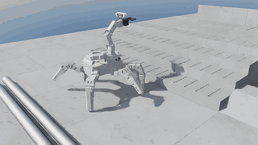
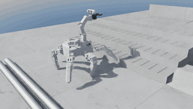
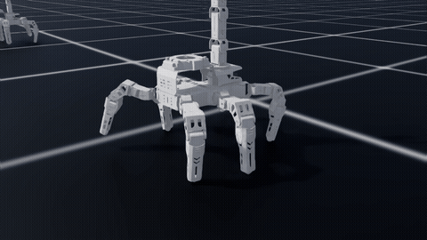
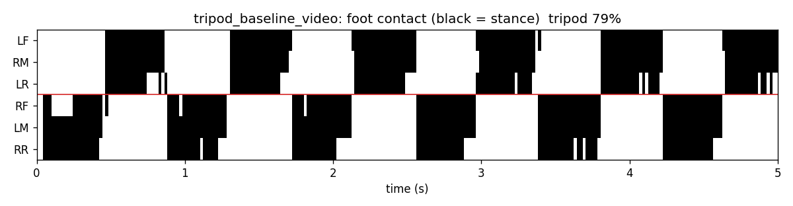
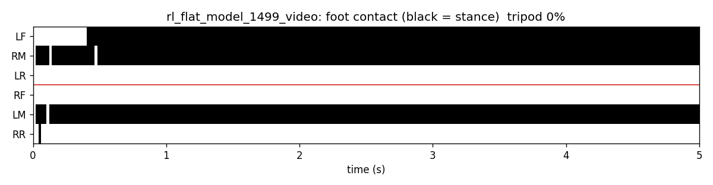
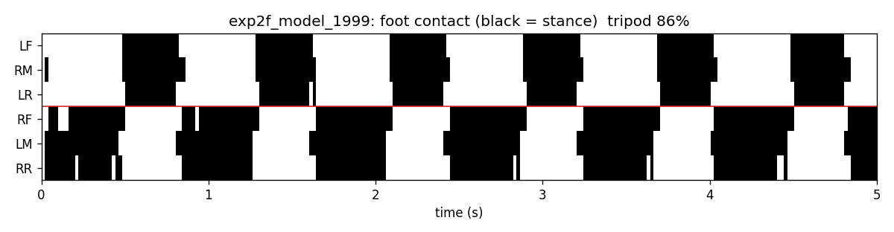

# RoSpider 보행 정책 요약 (평지 → 방지턱·구덩이 → 실물 코스)

> 시간순 자세한 기록은 [NIGHT_LOG.md](NIGHT_LOG.md), 보상 설계 배경은 [REWARD_DESIGN.md](REWARD_DESIGN.md)

## 결론

**땅을 못 보는(블라인드) CPG + RL 정책 (3-i)** 이 실물 코스 맵 1, 맵 2, 계단, 파이프를 10번씩 모두 완주한다. 미끄러운 바닥(마찰 0.5)에서도 39/40.
입력이 관절 · IMU · 명령 · 걸음 박자뿐이라 실물에 그대로 옮길 수 있다. 출발 위치 · 방향, 속도 명령을 바꿔 30번씩 다시 해도 대부분 완주해서 코스를 외운 게 아니다.
기존 걸음(손으로 짠 tripod)과 계단을 안 배운 블라인드 정책(3-a)은 맵 1 · 2 모두 0번이다. 막히던 곳은 계단이었다.

| 실물 코스 (각 10회, 60 s, 마찰 0.8) | 맵 1 | 맵 2 | 파이프만 | 계단만 |
|---|---|---|---|---|
| 기존 걸음 (손으로 짠 tripod) | 0 | 0 | 10 | 0 |
| 땅 못 보는 정책, 계단 안 배움 (3-a) | 0 | 0 | 10 | 0 |
| 땅 보는 정책 (3-e) | 10 | 8 | 10 | 8 |
| 땅 보는 정책 (3-f) | 8 | 9 | 10 | 10 |
| 땅 못 보는 정책, 계단까지 학습 (3-g) | 9 | 8 | 10 | 10 |
| **땅 못 보는 정책, 출력 범위 고침 (3-i, 최종)** | **10** | **10** | **10** | **10** |

<table>
<tr>
<th width="25%">기존 걸음: 계단에서 뒤집힘</th>
<th width="25%">계단 안 배운 블라인드 (3-a): 계단 앞 제자리걸음</th>
<th width="25%">땅 보는 정책 (3-f): 작업대까지</th>
<th width="25%">블라인드 최종 (3-i): 작업대까지</th>
</tr>
<tr>
<td></td>
<td></td>
<td></td>
<td></td>
</tr>
</table>

맵 1 전체 (구덩이 → 굴러가는 파이프 → 계단 4단 → 작업대). 영상은 2배속이다.


**남은 문제**
1. **평지에서 아직 명령보다 느리다.** 명령 0.18 m/s에 0.144 m/s. 출력 고착은 고쳐서 걸음이 1.0 Hz로 빨라졌지만 발 미끄러짐이 늘어 속도는 그대로다.
   도착 뒤 멈추는 명령도 아직 안 배웠다 (도착 뒤에도 계속 가서 용접판 위로 올라감).
2. **sim-to-real 차이.** 정강이 관절 속도가 착지 때 시뮬에서 100 rad/s 넘게 튄다 (실물 서보 최대 약 6 rad/s). 무게 분포도 실측과 다르다 ([개선점](#개선점--남은-일)).

## 진행 흐름

```
1단계 평지                 2단계 방지턱·구덩이           3단계 실물 코스
관절 18개 직접 (실패)  →   CPG + RL, 땅 못 봄      →    땅 못 봄: 계단 0 %
CPG + RL (통과)            방지턱·구덩이 통과            땅 봄: 맵 1·2 완주
```

| 단계 | 실험 | 바꾼 것 | 결과 | 다음 판단 |
|---|---|---|---|---|
| 1 평지 | 1 | 관절 18개 직접, 이동 점수만 | 다리 3개로 미끄러져 감 | 걸음 모양을 가르쳐야 함 |
| | 2-b | + 기존 걸음 따라 하기 강하게 | 걸음은 생김, 2배 과속, 옆으로 1.7 m | 속도·방향을 강하게 |
| | 2-c | 속도·방향 강하게 | 똑바로 가지만 한 다리를 들고 5발로 기어감 | 관절 직접 조종의 한계 |
| | **2-f** | **CPG(박자 신호기) + RL 보정** | **tripod 85 %, 방향 1.7°. 1단계 통과** | 같은 회사 로봇 논문과 같은 결론 |
| | 2-g | + 다리 높이 조절, 느린 걸음, 4스텝 기억 | 평지 걸음 유지 | 장애물 출발점 |
| 2 장애물 | **3-a** | 방지턱 10 cm·구덩이 7 cm까지 커리큘럼 | **구덩이 5 cm: 기존 11/20 → 19/20. 2단계 통과** | 실물 맵 평가 |
| 3 코스 | (3-a 평가) | 실물 맵 1·2 | 0/10, 전부 계단에서 뒤집힘 | 땅을 봐야 함 |
| | 3-c | 몸 앞 높이 지도(잡음 포함)를 정책에 | 맵 1 8/10, 맵 2 7/10 | 평지가 0.08 m/s로 느려짐 |
| | 3-d | 가짜 "물리 폭발" 종료 기준 고침 | 맵 2 9/10, 계단 10/10 | 평지 그대로 |
| | **3-e** | 넓은 속도 보상, 빨리 도착할수록 보너스 | **맵 1 10/10, 맵 2 8/10** | 평지 그대로 → 진짜 원인 발견 |
| | **3-f** | 행동 잡음 std 되돌리고 상한 0.8 | **맵 1 8, 맵 2 9, 계단 10/10.** 평지 그대로 | 실물엔 지도가 없음 → 블라인드로 계단 |
| | **3-g** | 블라인드(땅 못 봄)로 계단까지 학습 (3-a에서 3000회) | **맵 1 9, 맵 2 8, 계단 10/10, 평지 0.14 m/s** | 실물 후보. 출력 ±1 밖 고착 확인 |
| | 3-h | 3-g + ±1 밖 평균 끌어당기기 | 고착 풀림. 잡음이 실제로 걸음을 흔들어 학습 보상 반토막 → 160회에서 중단 | 잡음 줄이기 |
| | **3-i** | 3-h + 잡음 std 0.4 (상한 0.5), 엔트로피 0.002 | **맵 1 · 2 · 파이프 · 계단 모두 10/10. 평지 0.144 m/s, 옆 샘 5.5 cm** | 최종. 외우기 시험 통과 |

## 최종 정책 구성 (3-i, 블라인드)

박자 신호기(CPG)가 기존 tripod 걸음을 만들고, 정책은 그 걸음을 **조절**만 한다. 정책이 행동 0을 내면 기존 wasd 걸음과 같다.

| 항목 | 설정 |
|---|---|
| 정책 입력 | 몸 기울기·회전 속도(IMU), 방향 오차, 다리 18관절 각도·속도, 속도 명령, 직전 행동, 걸음 박자 (70개 × 최근 4스텝 = 280). **높이 지도 없음** → 실물 센서로 다 얻을 수 있음 |
| 정책 출력 (22개) | 걸음 크기(±30 %), 걸음 빠르기(0.5 ~ 1.3배), 좌우 회전(±25 %), 다리 드는 높이(0.5 ~ 1.5배), 관절 보정 18개(±0.2 rad) |
| critic 입력 (학습 때만) | 위 정보 + 몸 속도 + 깨끗한 높이 지도 + 파이프 위치·속도 |
| 지형 | 평지, 방지턱, 구덩이, 굴러가는 파이프, 그레이팅 계단 + 작업대, 맵 1·2 (높이 0.5배 → 실물 커리큘럼) |
| 무게 | 팀 실측 분포 (몸통 1673 g, 다리 197 g × 6, 팔 395 g = 3254 g) |
| 다리 힘 | 기존 걷기 스크립트 값 (강성 57.3, 감쇠 1.15, 토크 2.0) |
| 학습 | PPO, 2048마리 동시. 3-a(평지 → 방지턱·구덩이) 3500회 + 계단 코스 3000회(3-g) + 출력 범위 고침 1600회(3-h · 3-i). 계단부터 약 5.5시간 (RTX 4060 노트북) |
| 출력 범위 | 정책 평균이 ±1 밖으로 나간 만큼 역전파에서 끌어당김 (`--bound_coef 0.1`). 행동 잡음 std 0.4, 상한 0.5, 엔트로피 0.002 |

땅 보는 정책(3-f)은 여기에 **몸 앞 높이 지도** 209칸(앞 -0.15 ~ 0.75 m, 좌우 ±0.25 m, 5 cm 간격, 뎁스 카메라 잡음 가정)을 더한 것이다.

## 1단계: 평지

평지에서 15초, 16마리 평균, 명령 0.18 m/s. 접촉 그림의 검은색은 발이 땅에 닿은 구간이다 (위 3줄 A조, 아래 3줄 B조).

<table>
<tr>
<th width="33%">기존 걸음 (손으로 짠 tripod)</th>
<th width="33%">실험 1 (이동 점수만)</th>
<th width="33%">실험 2-f (CPG + RL)</th>
</tr>
<tr>
<td></td>
<td></td>
<td></td>
</tr>
<tr>
<td></td>
<td></td>
<td></td>
</tr>
<tr>
<td>두 조가 번갈아 딛지만 방향을 못 잡아 15초에 10° 돌고 옆으로 24 cm 샘</td>
<td>다리 3개로 미끄러져 감. 걸음 없음</td>
<td>거미처럼 번갈아 딛고 똑바로 감</td>
</tr>
</table>

| | 속도 | 방향 틀어짐 | 옆으로 | tripod 일치율 | 걸음 | 미끄러짐 |
|---|---|---|---|---|---|---|
| 기존 걸음 | 0.17 m/s | 10.0° | 0.24 m | 70.6 % | 1.22 Hz | 27 cm/s |
| 실험 1 | 0.11 m/s | 4.9° | 0.09 m | 0 % | 0 Hz | 8 cm/s |
| 실험 2-b | 0.33 m/s | 11.7° | 1.73 m | 35.5 % | 2.18 Hz | 12 cm/s |
| 실험 2-c | 0.16 m/s | 1.7° | 0.06 m | 16.2 % | 1.81 Hz | 19 cm/s |
| **실험 2-f** | **0.17 m/s** | **1.7°** | **0.13 m** | **85.3 %** | **1.23 Hz** | **17 cm/s** |
| 실험 2-g | 0.18 m/s | 3.1° | 0.06 m | 76.7 % | 1.15 Hz | 16 cm/s |

**CPG를 쓴 이유:** 관절 18개를 직접 조종하면 보상을 어떻게 바꿔도 "미끄러지기", "과속", "5발로 기기" 같은 꼼수가 나왔다.
같은 회사 로봇(Hiwonder JetHexa) 논문에서도 직접 조종은 코스 완주 20 %, CPG + RL은 88 %였다.
CPG가 걸음 모양을 보장하니 정책은 "똑바로, 정해진 속도로"만 배우면 된다.

## 2단계: 방지턱·구덩이 (3-a, 땅 못 봄)

2-g에서 이어서 학습했다. 높이를 낮게 시작해 방지턱 10 cm, 구덩이 7 cm까지 올렸다 (실물은 8 cm / 4.7 cm).

| 장애물 (각 20회) | 마찰 0.8 정책 | 마찰 0.8 기존 | 마찰 0.5 정책 | 마찰 0.5 기존 |
|---|---|---|---|---|
| 방지턱 8 cm × 폭 40 / 50 / 60 | 20 / 20 / 20 | 20 / 20 / 20 | 20 / 20 / 20 | 20 / 20 / 20 |
| 구덩이 5 cm × 25 | **19** | 11 | **20** | 12 |
| 구덩이 7 cm × 25 | **11** | 1 | | |
| 방지턱 12 cm × 40 (학습 범위 밖) | 3 | **11** | | |

- 기존 걸음은 구덩이 바닥에서 앞발이 턱에 걸려 제자리걸음을 한다. 정책은 다리를 더 들어 빠져나온다.
- 약점: 학습 범위 밖 높이(12 cm)에서는 기존 걸음보다 못하다.
- 평지 걸음은 유지된다: 0.177 m/s, tripod 74 %, 발 7.2 cm.


## 3단계: 실물 코스

### 땅을 못 보면 계단을 못 오른다

3-a를 실물 맵에 그대로 넣으면 맵 1·2 모두 0/10이고, 전부 계단에서 뒤집힌다. 계단은 4단에 단 높이 6 cm, 디딤판 15 cm다.
디딤판이 몸 길이(약 40 cm)보다 짧아서 앞다리와 뒷다리가 서로 다른 단에 걸친다. 단 높이를 모르면 헛디딘다.
파이프는 계단 바로 앞 15 cm에 있어서 처음에는 원인이 섞여 보였다. 파이프만, 계단만 따로 시험해서 계단이 원인임을 확인했다.

### 땅을 보는 정책 (3-c → 3-e)

- 몸 앞 높이 지도를 정책에 넣었다. 실물에서는 손목 뎁스 카메라 + 다리 odometry로 만든다고 가정했다.
- 굴러가는 파이프는 지형 레이캐스트에 안 잡혀서, 원통 윗면 높이를 직접 계산해 지도에 합쳤다.
- 3-a 가중치에 새 입력 칸을 0으로 붙여 이어 받았다. 그래서 처음 행동은 3-a와 같고 장애물 실력을 그대로 가져간다.
- 결과: 앞다리를 높이 들어 다음 단에 올려놓으며 작업대까지 올라간다.

| 땅 보는 정책 (각 10회) | 맵 1 | 맵 2 | 파이프만 | 계단만 | 평지 속도 |
|---|---|---|---|---|---|
| 3-c | 8 | 7 | 10 | 8 | 0.080 m/s |
| 3-d | 7 | 9 | 10 | 10 | 0.080 m/s |
| **3-e** | **10** | **8** | **10** | **8** | 0.083 m/s |
| **3-f** | **8** | **9** | **10** | **10** | 0.082 m/s |

### 강건성 (각 10회, 맵 1 / 맵 2 / 파이프만 / 계단만)

| 조건 | 3-e | 3-f | 뜻 |
|---|---|---|---|
| 기본 (지도 잡음 1배, 마찰 0.8) | 10 / 8 / 10 / 8 | 8 / 9 / 10 / 10 | |
| 지도 잡음 2배 | 9 / 9 / 10 / 10 | 8 / 9 / 10 / 10 | 잡음에 강함 |
| 미끄러운 바닥 (마찰 0.5) | 8 / 9 / 10 / 9 | 8 / 9 / 10 / 8 | 거의 그대로 |
| **지도를 평지로 (안 보이게)** | 4 / 5 / 10 / 5 | 7 / 5 / 10 / 4 | 계단 성공이 절반으로 → **지도를 실제로 씀** |

- 지도를 지워도 절반은 오른다. "천천히, 발 높이" 걸음 자체가 계단에 유리하다는 뜻이다.
- 같은 이유로 평지에서도 느린 걸음을 쓰는 것으로 보인다.

### 땅 못 보는 정책으로 계단까지 (3-g)

- 실물에는 높이 지도가 없으니, 지도 없이 계단을 배우게 했다. 3-a(방지턱 · 구덩이만 배움)에서 이어서 계단 들어간 코스로 3000회.
- 3-d ~ 3-f에서 고친 것(물리 폭발 기준 500, 넓은 속도 보상, 속도 비례 도착 보너스, std 상한 0.8)을 같이 넣었다.

| 블라인드 (각 10회) | 맵 1 | 맵 2 | 파이프만 | 계단만 | 평지 속도 |
|---|---|---|---|---|---|
| 3-a (계단 안 배움) | 0 | 0 | 10 | 0 | 0.177 m/s |
| **3-g** | **9** | **8** | **10** | **10** | **0.140 m/s** |
| 3-g, 마찰 0.5 | 8 | 8 | 10 | 8 | |

- 땅 보는 정책(3-f)과 성공률이 같다. 높이 지도는 이 코스(단 6 cm)에서는 꼭 필요하지 않았다.
- 평지 걸음: 0.73 Hz, 발 12.6 cm (3-f는 0.64 Hz, 14.5 cm). 옆으로 15초에 17 cm 샘 (3-f 8 cm), tripod 일치율 55 % (3-f 76 %).

### 정책 출력이 ±1 밖에 붙어 있음 (평지 느림의 원인)

`course_eval --dump_actions`로 자르기 전 정책 평균을 찍었다 (평지, 4대 x 20초, 5 % ~ 95 % 범위).

| | 보폭 | 걸음 주기 | 회전 | 발 높이 |
|---|---|---|---|---|
| 3-a | -4.5 ~ 6.5 | -1.8 ~ 5.0 | -1.1 ~ 1.4 | -3.3 ~ 2.4 |
| 3-c | -15.7 ~ 11.0 | **-14.1 ~ -4.7** | **3.2 ~ 9.2** | -15.2 ~ 15.2 |
| 3-f | -54 ~ 61 | **-48 ~ -27** | **21 ~ 40** | -60 ~ 53 |
| 3-g | -2.9 ~ 5.7 | -3.6 ~ 1.6 | -2.8 ~ 4.0 | -3.9 ~ 4.1 |

- 행동은 ±1로 잘린다. 3-f는 걸음 주기가 항상 -1(최저 주기), 회전이 항상 +1(한쪽으로 계속 도는 명령을 다리 보정이 상쇄)이다.
- 평균이 ±1 밖 멀리 있으면 샘플이 전부 같은 값으로 잘려서 보상 차이가 없고, 그 차원은 기울기가 0이 된다. 그래서 속도 보상을 바꿔도 안 움직였다.
- 3-g는 덜 붙어 있지만 평균이 거의 늘 ±1 밖이라 양 끝을 오가는 걸음이다.
- 고친 것 (3-h): `train.py --bound_coef`. 정책 평균이 ±1 밖으로 나간 만큼만 역전파에서 끌어당긴다 (rl_games의 bounds loss). 앞 계산은 그대로라 지금 (잘린) 행동은 안 바뀌고 기울기만 되살아난다.
- 3-h: 50번 업데이트 만에 ±1 밖 비율 87 % → 16 ~ 24 %. 대신 이제 잡음(std 0.75)이 범위 안에서 실제로 걸음을 흔들어 학습 보상이 반으로 (회전 · 옆 속도 추종이 크게 떨어짐). 160회에서 끊음.
- 3-i: 잡음 std 0.4 (상한 0.5), 엔트로피 0.005 → 0.002로 1500회. 자르기 전 평균이 평지에서 5 % ~ 95 % 모두 ±1.1 안으로 들어옴.

| 블라인드 (평지 15초, 16대) | 3-g | **3-i** |
|---|---|---|
| 전진 속도 (명령 0.18) | 0.140 m/s | **0.144 m/s** |
| 걸음 빠르기 | 0.73 Hz | **1.00 Hz** |
| 옆으로 샘 | 17 cm | **5.5 cm** |
| tripod 일치율 | 55 % | **72 %** |
| 닿은 발 미끄러짐 | 12.6 cm/s | 15.9 cm/s (나빠짐) |

| 코스 (각 10회) | 맵 1 | 맵 2 | 파이프만 | 계단만 |
|---|---|---|---|---|
| **3-i** | **10** | **10** | **10** | **10** |
| 3-i, 마찰 0.5 | 9 | 10 | 10 | 10 |

### 코스를 외운 건 아닌지 (각 30회, 맵 1 / 맵 2 / 계단만)

코스가 고정이라 블라인드 정책이 "몇 걸음 가면 오르기"를 외웠을 수 있다 (검토 AI 지적). 출발 위치와 속도 명령을 바꿔서 계단까지 걸음 수를 바꿨다.
출발 위치는 뒤에 치워 둔 파이프(-0.40 m)와 첫 장애물(+0.30 m) 때문에 -0.12 ~ +0.03 m까지만 옮길 수 있었다.

| 조건 | 3-g | **3-i** |
|---|---|---|
| 출발 x -0.12 ~ +0.03 m, 방향 ±0.2 rad (학습 ±0.15) | 27 / 29 / 25 | **30 / 30 / 28** |
| 속도 명령 0.12 m/s (학습 범위 0.14 ~ 0.20 밖) | 25 / 26 / 26 | 30 / 23 / 30 |
| 속도 명령 0.15 m/s | 27 / 27 / 26 | **30 / 30 / 30** |
| 속도 명령 0.20 m/s | 22 / 26 / 22 | **28 / 29 / 28** |

- 조건을 바꿔도 거의 다 완주한다. 걸음 수를 세서 오르는 게 아니라 관절 · IMU로 느끼는 것에 반응한다고 본다 (직접 확인한 건 아님).
- 3-i 맵 2 / 0.12 m/s만 23/30. 학습 범위 밖 속도다. 실패 7번 중 5번은 계단에서 멈췄고, 2번은 작업대에 올랐지만 60초 안에 목표 거리를 못 채웠다.
- 아직 안 한 것: 단 높이 · 디딤판 길이를 바꾼 시험. 지금 계단은 학습과 같은 6 cm / 15 cm뿐이다.

## 문제와 고친 것

| 문제 | 증상 | 원인 | 고친 것 |
|---|---|---|---|
| 학습 발산 (2번) | 3-c 4303·4407회에 critic 손실 폭발, 학습 중단 | 목표 도착을 `time_out`으로 둬서 rsl_rl이 "지금 상태 가치 × 0.99"를 더함. 도착이 77 %로 잦아지자 critic이 자기 값을 키움 | 도착 = 진짜 종료 + 도착 보너스 |
| 행동 값 튐 | "직전 행동" 관측에 100 ~ 180 | 정책 출력이 잘리기 전 값으로 들어감 | `clip_actions = 1` |
| 가짜 물리 폭발 | 정상 걸음 7.5 %가 실패로 끝남 | 정강이 관절이 착지 때 60 ~ 146 rad/s로 튐. 기존 걸음도 평균 80 rad/s | 기준 60 → 500 rad/s |
| 잡음 폭주 | 학습 중 행동 잡음 std 1 → 15 | 행동을 ±1로 자른 뒤 std 상한이 없어 엔트로피 보너스가 계속 키움. 학습 중 행동이 거의 무작위 | std 0.5로 되돌리고 상한 0.8 (3-f). 평지 속도는 안 바뀜 |
| 출력 고착 | 보상을 바꿔도 평지 속도가 안 변함 | 정책 평균이 ±1 밖(3-f 주기 -38)에 붙어 잘린 샘플이 다 같음 → 복원력 없이 바깥으로 흘러감 | ±1 밖 평균 끌어당기기 + 잡음 줄이기 (3-i). 옆 샘 17 → 5.5 cm |
| 평가 버그 | 4개 코스 중 2개만 평가 | 로봇 수가 "2 × 시도"로 고정 | 코스 수 × 시도 |

교훈: 숫자만 보고 판단하지 않았다. 영상 프레임, 관절 속도 기록, 체크포인트 안의 std까지 열어 보고 원인을 찾았다. 검토 AI의 가설(가짜 종료가 느려짐의 원인)도 실험으로 확인해 보니 틀렸다.

## 개선점 / 남은 일

| 항목 | 내용 | 우선순위 |
|---|---|---|
| 평지 속도 | 출력 고착은 고쳤고 걸음은 1.0 Hz로 빨라졌지만 0.144 m/s 그대로. 발 미끄러짐이 늘어서 보폭이 땅에 안 실리는 것으로 보임. 미끄러짐 벌점 · 보폭 쪽 확인 필요 | 중간 |
| 정지 · 회전 명령 | 직진 0.14 ~ 0.20 m/s만 학습. 도착 뒤 멈추지 않음. 정지(0), 회전, 옆걸음 명령을 넣어 학습해야 실물 조종 가능 | 높음 |
| 단 높이 바꾼 시험 | 단 4 ~ 8 cm, 디딤판 12 ~ 18 cm로 바꿔 블라인드가 어디까지 되는지. 지금은 학습과 같은 6 cm / 15 cm만 확인 | 높음 |
| 관절 속도 튐 (sim-to-real) | 시뮬에서 정강이가 100 rad/s 넘게 튐. 실물 서보 최대는 약 6 rad/s. `solver_velocity_iteration_count` 0 → 1~4, 다리 armature 0.005~0.01, 관절 속도 벌점. 물리가 바뀌므로 기준선부터 다시 잡기 | 높음 |
| 실물 높이 지도 (선택) | 블라인드 3-g로 지금 코스는 됨. 더 높은 계단이 필요할 때만. 손목 뎁스 카메라(Aurora930 Pro)는 15 cm 안쪽에서 depth가 안 나옴. 팔 자세를 정해 몸 앞 0.15 ~ 0.75 m를 보게 하고 odometry와 합치는 파이프라인 필요 | 실물 전 필수 |
| 무게 | URDF 질량 합 1.66 kg, 실측 3.25 kg. 지금은 실측 분포를 덮어씀. 몸통 무게 중심은 미확인 | 중간 |
| 파이프 물리 | 속이 찬 원통 관성으로 넣어서 실물보다 잘 구름 (보수적인 쪽) | 낮음 |

## 영상 위치

- 쉬운 이름 모음: `~/Rospider_RL/` (1_평지걸음, 2_실물코스, 3_로봇1마리_파이프·계단 따로, 4_땅보는 강화학습 고쳐서 다시, 5_땅 못보는 강화학습 계단까지, 6_땅 못보는 강화학습 출력 범위 고친 뒤 (최종)). 각 폴더에 `읽어보기.txt` 설명이 있다.
- 원본: `outputs/obstacle_rl/gait_eval/<실험>/`, `outputs/obstacle_rl/course_eval/<실험>/`
