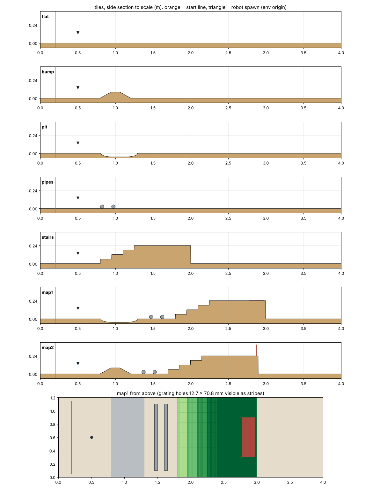

# 장애물 넘기 강화학습 (`tasks/obstacle_rl/`)

RosPider 가 실물 장애물 코스(방지턱 / 구덩이 / 굴러가는 파이프 / 그레이팅 계단 → 작업대)를
넘도록 Isaac Lab 2.3.x + RSL-RL PPO 로 학습한다.



## 실행 (컨테이너 `isaac-shell` 안, 레포 루트에서)

```bash
# 1회: 베이스가 떠 있는 USD (보행이라 고정 베이스 USD 는 못 쓴다)
python tasks/sensor_fusion/02_urdf_to_usd.py --no-fix-base

# 지형만 검사 (Kit 불필요, 아무 파이썬)
python tasks/obstacle_rl/test_course.py

# 학습 (헤드리스 필수, VRAM 8 GB 는 64 부터 두 배씩 올려 한계 찾기)
python tasks/obstacle_rl/train.py --headless --num_envs 64

# 평가: 실물 맵 1, 맵 2 에서 작업대까지 가나
python tasks/obstacle_rl/play.py --checkpoint logs/rsl_rl/rospider_obstacle/<날짜>/model_3000.pt
```

## 지형

실물 치수 그대로 (`course.py` 위쪽 표). 타일 4.0 x 1.2 m, 바닥 윗면 z = 0.

| 타일 | 내용 | 학습 비율 |
|---|---|---|
| flat | 평지 | 0.08 |
| bump | 과속방지턱 0.40 x 0.08 (사다리꼴) | 0.14 |
| pit | 구덩이 0.50, 깊이 0.047 (둥근 단면) | 0.14 |
| pipes | 파이프 Ø48.6 x 1.0 두 개, 간격 0.10, **굴러감** | 0.14 |
| stairs | 그레이팅 계단 0.06 x 4 + 작업대 0.24 + ㄴ자 판 | 0.18 |
| map1 | 구덩이 → 파이프 → 계단 → 작업대 (실물 맵 1) | 0.16 |
| map2 | 방지턱 → 파이프 → 계단 → 작업대 (실물 맵 2) | 0.16 |

- 출발선 ~ 첫 장애물 0.60, 파이프 앞뒤 0.15. 출발선 ~ 작업대 끝: 맵 1 2.797 m, 맵 2 2.697 m.
- 그레이팅은 위아래로 뚫린 메시다 (구멍 12.7 x 70.8 mm, 살 3 / 4 mm). 높이맵으로는 구멍을 못 그려서
  **지형 전체를 메시 방식**으로 만든다.
- 파이프는 지형이 아니라 env 마다 두 개씩 있는 RigidObject 다. 리셋 때 타일 종류를 보고 자리를 정하고,
  파이프가 없는 타일에서는 로봇 뒤에 치워 둔다 (`mdp.reset_pipes`).

### 높이: 실물 고정이 기본, 커리큘럼은 옵션

- 기본은 **모든 행이 실물 높이**다. 시뮬 테스트에서 기본 삼각보행이 방지턱 8 cm(길이 40 cm),
  구덩이 5 cm 를 이미 넘었으므로, 처음부터 실물 높이여도 성공 경험이 생길 것으로 본다.
- 학습 곡선이 안 오르면 `--height_curriculum`: 행(난이도)에 따라 방지턱 / 구덩이 / 계단 한 단 높이를
  0.5 배 → 1 배로 키운다. Isaac Lab 기본 보행 예제(울퉁불퉁 지형)가 쓰는 방식과 같다.
- 실물 배치를 외우지 않도록 단독 장애물 타일과 실물 순서 맵을 섞고, 마찰 / 질량 / 출발 자세 / 명령 방향을 흔든다.
  평가(`play.py`)는 실물 맵만 쓴다.

## 환경 (`env_cfg.py`)

Isaac Lab `LocomotionVelocityRoughEnvCfg`(ANYmal, Go2 가 쓰는 보행 틀)를 물려받아 바꾼다.

| 구분 | 내용 |
|---|---|
| 관측 | 몸 선속도 / 각속도, 중력 방향, 속도 명령, 다리 관절각 / 속도, 직전 행동, 높이 스캔 0.8 x 0.6 m (4 cm 간격, 몸 앞 15 cm 중심) |
| 행동 | 다리 18개 목표각 = 선 자세 + 0.25 x 출력 [rad]. 팔(카메라 자세) / 그리퍼 고정 |
| 명령 | 전진 0.04 ~ 0.12 m/s, 옆 ±0.02, 방향 유지 ±0.15 rad |
| 보상 | 속도 추종(std 0.05), **전진 진척**, 발 들기 시간(0.3 s 이상), 수직 / 기울기 흔들림, 토크, 행동 변화, 허벅지 충돌, 관절 한계 |
| 종료 | 40 s, 몸통 접촉, 1 rad 넘게 기울어짐 (평가 때는 작업대 도착도 종료) |
| 무작위화 | 마찰 0.5 ~ 1.0, 몸통 질량 +0.8 ~ 1.8 kg (URDF 1.66 → 실물 3.2), 출발 위치 / 방향, 약한 밀기, 파이프 위치 ±3 cm |

선 자세는 `gait.py` IK(몸 높이 0.12, 발 반경 0.126)로 계산한다.

## 확인한 것 / 안 한 것

| | 상태 |
|---|---|
| 지형 기하 (닫힌 메시, 실물 수치, 그레이팅 구멍, 배치) | `test_course.py` 36개 통과 |
| Isaac Lab 에서 지형 생성 / 환경 생성 / 학습 | **한 번도 안 돌렸다.** 코드 작성 환경에 Isaac Lab 이 없었다 |
| `column_kinds` 규칙이 Isaac Lab 생성기와 같은가 | v2.3.1 소스를 기억해 옮겼다. 첫 실행 때 파이프가 맞는 타일에 놓이는지 GUI 로 볼 것 |
| 보상 가중치, PPO 설정, 다리 PD 게인 | 출발값. 실험으로 조정 필요 |

## 알려진 한계

- **높이 스캔에 파이프가 안 보인다.** RayCaster 는 정적 지형(/World/ground)만 본다. 정책은 발 접촉으로만 파이프를 느낀다.
- **높이 스캔은 특권 관측이다.** 실기에는 없다. 실기로 옮기려면 뎁스 카메라 관측으로 바꾸거나(증류) 뎁스에서 스캔을 만들어야 한다.
- 파이프 관성이 꽉 찬 원통 값(m r²/2)이다. 실제 관(약 m r²)보다 잘 구른다.
- 파이프 질량 2.08 kg 은 Ø48.6 x 1.8T 강관 계산값. 실물을 달아서 바꿀 것 (`course.PIPE_MASS`).
- ㄴ자 용접판 크기(0.20 x 0.60, 세운 판 0.15)는 가정값이다.
- 그레이팅 블록 하나하나가 상자라 타일 하나에 메시 조각이 약 120 개다. 지형 생성은 시작할 때 한 번뿐이라 학습 속도와는 무관할 것으로 본다.
