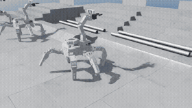
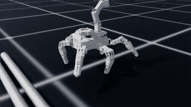

# 장애물 넘기 강화학습 (`tasks/obstacle_rl/`)

RosPider 가 실물 장애물 코스(방지턱 / 구덩이 / 굴러가는 파이프 / 그레이팅 계단 → 작업대)를
넘도록 Isaac Lab 2.3.x + RSL-RL PPO 로 학습한다. `isaac-shell` 안, 레포 루트에서 실행한다.

```bash
python tasks/sensor_fusion/02_urdf_to_usd.py --no-fix-base        # 1회: 몸이 고정되지 않은 USD
python tasks/obstacle_rl/test_course.py                           # 지형 검사 (Kit 불필요)
python tasks/obstacle_rl/train.py --headless --num_envs 64        # 학습 (--height_curriculum 옵션)
python tasks/obstacle_rl/play.py --checkpoint logs/rsl_rl/rospider_obstacle/<날짜>/model_3000.pt   # 실물 맵 1, 2 평가
```

| 파일 | 내용 |
|---|---|
| `course.py` | 실물 치수, 칸 배치, 메시 생성 (numpy 만) |
| `terrain_cfg.py` | Isaac Lab 지형 생성기 설정 (학습 맵 / 평가 맵) |
| `robot_cfg.py` | 떠 있는 베이스 USD, 다리 게인, 선 자세 |
| `env_cfg.py` | 관측 / 행동 / 명령 / 보상 / 종료 / 무작위화 |
| `mdp.py` | 굴러가는 파이프 배치, 전진 보상, 작업대 도착 판정 |
| `agents/rsl_rl_ppo_cfg.py` | PPO 설정 |
| `train.py`, `play.py` | 학습, 평가 |
| `test_course.py` | 지형 기하 검사 |

**상태 (2026-11-10)**: 땅을 못 보는(블라인드) CPG + RL 정책(3-m)이 실물 코스 맵 1 40/40, 맵 2 · 파이프 · 계단 20/20 완주 (기존 걸음 맵 0/10).
멈추기 · 제자리 돌기 · 걸으며 돌기 명령도 따르고, 착지 때 관절 속도가 실물 서보 한계(약 6 rad/s) 안이다. 최종 정책 파일은 [`policy/`](policy/).
결과와 흐름은 [POLICY_SUMMARY.md](POLICY_SUMMARY.md), 시간순 기록은 [NIGHT_LOG.md](NIGHT_LOG.md).

<table>
<tr>
<th width="50%">기존 걸음: 계단에서 뒤집힘</th>
<th width="50%">최종 정책 (3-m): 맵 1 완주</th>
</tr>
<tr>
<td></td>
<td></td>
</tr>
<tr>
<th>평지: CPG + RL 걸음</th>
<th>명령 따라하기: 직진 → 정지 → 제자리 돌기 → 걸으며 돌기</th>
</tr>
<tr>
<td></td>
<td></td>
</tr>
</table>

영상은 2배속. 맵 1 = 구덩이 → 굴러가는 파이프 → 계단 4단 → 작업대.

실험 하나 돌리기: `bash tasks/obstacle_rl/run_exp.sh <실험> <회수> 0.18 <이어받을 체크포인트>` (실험 목록은 `experiments.py`),
코스 평가: `python tasks/obstacle_rl/course_eval.py --headless --controller policy --exp <실험> --checkpoint <ckpt> --maps map1 map2 pipes stairs`.
